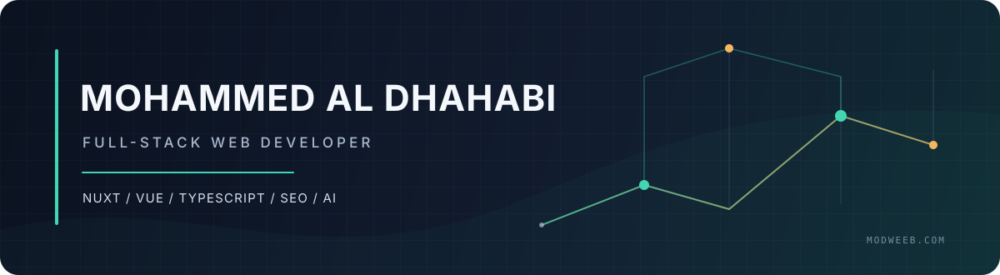

  

<h1 align="center">Mohammed Al Dhahabi</h1>

  <strong>Full-Stack Web Developer</strong> 
  Nuxt · Vue · TypeScript · SEO · AI Tools

  
  

---

## About

I build practical web experiences and creator-focused tools. My work brings together full-stack development, the Vue and Nuxt ecosystem, TypeScript, search optimization, and AI-powered features.

Through **[ModWeeb](https://www.modweeb.com)**, I explore useful ways to make publishing and web workflows simpler.

## Selected work

- **[ModApp](https://github.com/zerootem/modapp)** — A home for practical web tools and creative utilities.
- **[Article Generator Tool](https://github.com/zerootem/article-generator-tool)** — An Arabic article-generation tool with Puter AI integration.
- **[AI Chat Embed](https://github.com/zerootem/ai-chat-embed)** — A lightweight JavaScript/CSS project for embedding a chat interface.

## Technology

  
  
  
  
  
  

## GitHub activity

  

  

Statistics refresh automatically every day from public GitHub activity.

  
نبذة بالعربية

  

    
محمد الذهبي، مطوّر ويب متكامل. أعمل على تطبيقات الويب وأدوات النشر باستخدام Nuxt وVue وTypeScript، مع اهتمام بتحسين محركات البحث ودمج الذكاء الاصطناعي.

    
<a href="https://www.modweeb.com">مدونة ModWeeb</a>

  

